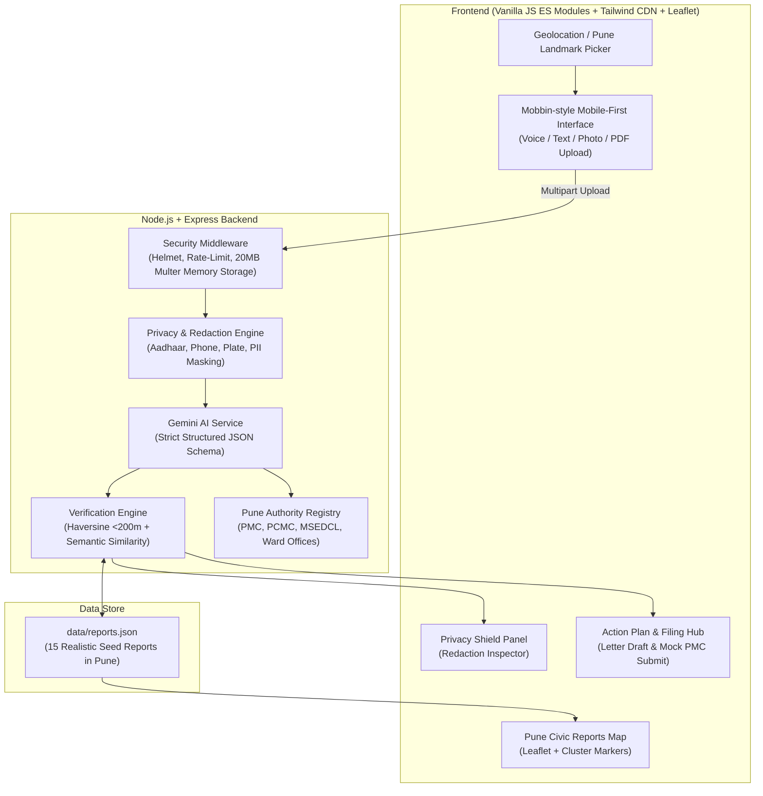

# CivicBridge 🌉
> **Gemini-powered civic complaint structuring, verification, and action planner for Pune, India.**

CivicBridge bridges the gap between frustrated citizens and municipal engineers by transforming messy, emotional, and multilingual citizen grievances (drainage overflows, craters, broken streetlights, waste accumulation) into structured, verified, and legally actionable municipal reports.

Designed specifically for the Pune metropolitan region (Pune Municipal Corporation - PMC, Pimpri Chinchwad Municipal Corporation - PCMC, Mahavitaran/MSEDCL, and Pune Traffic Police).

---

## 🚀 Live Demo & Tech Stack

* **Backend:** Node.js (>=20) + Express, Helmet (configured CSP), Express Rate Limit, Multer (in-memory buffer storage), CORS.
* **Frontend:** Plain HTML5, Tailwind CSS (via CDN), Vanilla JavaScript (ES Modules, zero build step), Leaflet.js map with custom SVG pins and 200m spatial radius rings.
* **AI & Intelligence:** Google Gemini (`@google/generative-ai`) with strict JSON Schema structuring, multimodal audio/image analysis, and Marathi/Hindi/English grievance letter drafting.
* **Security & Privacy:** Statutory **Privacy Shield** engine redacting Aadhaar numbers, Indian mobile numbers, vehicle license plates (MH-12/14), and complainant names prior to persistent storage. **Zero Raw Media Retention Guarantee.**

---

## 🏛️ System Architecture



---

## 📋 End-to-End Civic Flow

1. **Multilingual Intake (Step 1):**
   * Single-screen mobile-first intake supporting typed text, real-time voice notes via browser `MediaRecorder`, and photo/video/PDF attachments (<=20MB).
   * Seamlessly understands English, Marathi (मराठी), and Hindi (हिंदी).
   * 1-click quick-testing prompt pills for common Pune spots (Baner pothole, Kothrud sewage, Koregaon Park live wire, Viman Nagar waste).
2. **AI Structuring (Step 2):**
   * Sends prompt and multimodal attachments to Gemini using a strict JSON schema.
   * Extracts: `category`, `subcategory`, `severity` (1-5), `description` (clean & formal), `location_text`, `lat`/`lng`, `evidence_summary`, `urgency_reason`, `responsible_authority`, and `confidence`.
3. **Spatial & Community Verification (Step 3):**
   * Computes Haversine great-circle distance (<200m) against `data/reports.json`.
   * Analyzes category alignment and semantic similarity.
   * Outputs community consensus: *"X other people reported this"*, nearby duplicate tracking references, and a composite Verification Score (e.g., 96% Verified).
4. **Action Plan & Authority Routing (Step 4):**
   * Generates a 4-stage municipal resolution roadmap (Grievance Logging -> Ward Inspection -> Crew Rectification -> Civic Audit).
   * Identifies the exact Pune civic body with helplines (`1800 1030 222`), WhatsApp bots, and official resolution SLAs (24h to 72h).
   * Provides step-by-step online filing instructions and offline ward office blueprints (addresses, timings, documents to carry).
   * Explains community impact.
5. **"File This Complaint" Hub (Step 5):**
   * **Online Route:** Copy-ready pre-formatted complaint text + 1-click "Open official portal" button directly linking to the municipal grievance portal.
   * **Offline Route (Ward Visit):** Office name, specific office address, required documents checklist, best time to visit (e.g. 10:30 AM - 1:00 PM), and exact speaking script ("what to say") to present to the Ward Junior Engineer.
   * **Direct Share:** 1-click WhatsApp (`wa.me`) and Email (`mailto:`) buttons prefilled with the formal grievance letter.
   * **Tracking & Status Timeline:** Generates official tracking token (`PMC-2026-XXXXX`), appends redacted report to `data/reports.json`, and visualizes a 4-stage lifecycle timeline: `Submitted -> Verified -> Forwarded -> Resolved`.
6. **Formal Letter Drafter & Privacy Shield:**
   * Generates official grievance applications in English, Marathi (औपचारिक मराठी तक्रार अर्ज), or Hindi, complete with subject line and statutory SLA citations.
   * Masks 12-digit Aadhaar numbers (`XXXX-XXXX-1234`), Indian mobile numbers (`+91 98***-**34`), vehicle plates (`MH-12-XX-XXXX`), and names.
   * Discards raw media files from memory immediately following feature extraction (Zero Raw Media Retention).
   * Mandatory citizen consent checkbox.

---

## 📂 Project Structure

```
CivicBridge/
├── data/
│   └── reports.json           # 15 realistic seed reports across Pune
├── public/
│   ├── css/
│   │   └── style.css          # Custom audio wave animation, pulse rings, scrollbar
│   ├── js/
│   │   ├── api.js             # Fetch wrapper for backend endpoints
│   │   ├── app.js             # Main orchestrator & UI event controller
│   │   ├── audio.js           # MediaRecorder voice recording & timer
│   │   ├── map.js             # Leaflet map controller & 200m radius ring
│   │   └── ui.js              # Mobbin-style card renderers & toasts
│   └── index.html             # Mobile-first single-page interface
├── server/
│   ├── config/
│   │   └── authorities.json   # Pune municipal departments, helplines & ward offices
│   ├── routes/
│   │   ├── authorityRoutes.js # /api/authorities endpoints
│   │   └── complaintRoutes.js # /api/complaints endpoints (analyze, draft, submit)
│   ├── services/
│   │   ├── actionPlanService.js # SLA routing, online/offline blueprints
│   │   ├── geminiService.js   # Gemini structured JSON schema & letter drafter
│   │   ├── redactService.js   # PII Privacy Shield (Aadhaar, Phone, Plates)
│   │   └── verificationService.js # Haversine <200m & similarity cross-check
│   ├── tests/
│   │   ├── api.test.js        # Server and data integration tests
│   │   ├── redact.test.js     # Privacy Shield unit tests
│   │   └── verification.test.js # Haversine & verification engine tests
│   ├── utils/
│   │   ├── geo.js             # Haversine distance & Pune boundary check
│   │   └── validators.js      # 20MB file limit & payload validation
│   └── index.js               # Express application entrypoint
├── .env.example               # Environment template
├── .gitignore                 # Secrets & dependency exclusions
├── package.json               # Scripts, engines >= 20, dependencies
└── README.md                  # Documentation & deployment guide
```

---

## 🛠️ Local Setup & Quickstart

### Prerequisites
* **Node.js** `>= 20.0.0`
* **npm** `>= 10.0.0`
* Optional: Google Gemini API Key ([Google AI Studio](https://aistudio.google.com/)). *If omitted, CivicBridge automatically operates in deterministic Smart Demo Mode with zero runtime errors.*

### Installation

1. **Clone the repository and install dependencies:**
   ```bash
   npm install
   ```

2. **Configure Environment Variables:**
   ```bash
   cp .env.example .env
   ```
   Edit `.env`:
   ```env
   PORT=3000
   GEMINI_API_KEY=your_gemini_api_key_here
   GEMINI_MODEL=gemini-2.5-flash
   NODE_ENV=development
   ```

3. **Run the Test Suite:**
   ```bash
   npm test
   ```

4. **Start the Application:**
   ```bash
   npm start
   ```
   Open your browser at `http://localhost:3000`.

---

## ☁️ Deployment on Render

CivicBridge is pre-configured and 100% production-ready for [Render](https://render.com/):

1. **Create a New Web Service** on Render and connect this repository.
2. Configure settings:
   * **Environment:** `Node`
   * **Node Version:** `20` or higher (`engines: {"node": ">=20"}` enforced)
   * **Build Command:** `npm install`
   * **Start Command:** `npm start` (runs `node server/index.js`)
   * **Health Check Path:** `/health`
3. Under **Environment Variables**, add:
   * `GEMINI_API_KEY`: Your Gemini API key from AI Studio
   * `GEMINI_MODEL`: `gemini-2.5-flash`
   * `NODE_ENV`: `production`
4. Deploy! Render automatically routes incoming HTTPS traffic to `process.env.PORT`.

---

## 🔒 Security & Privacy Notes

* **Statutory Compliance:** Aligned with India's Digital Personal Data Protection Act (DPDPA 2023).
* **Zero Storage of Raw Media:** All uploaded photos, audio files, and PDFs are retained strictly in temporary memory buffers (`multer.memoryStorage()`) and zeroed out immediately after processing. No raw citizen media files are stored on disk.
* **Strict PII Redaction:** Automated regex masking of 12-digit Aadhaar numbers, 10-digit Indian phone numbers (`+91/0`), vehicle registration numbers (`MH-12/14`), and personal names.
* **HTTP Security Headers:** Protected by `helmet` with custom Content Security Policies (CSP) permitting Leaflet maps and OpenStreetMap tiles.
* **DDoS & Rate Limiting:** Protected by `express-rate-limit` (120 requests per 15 minutes per IP).
* **Upload Limits:** Enforces a strict 20MB payload ceiling and validates MIME types.

---

## 📄 License
MIT License. Built for the citizens of Pune, India.
