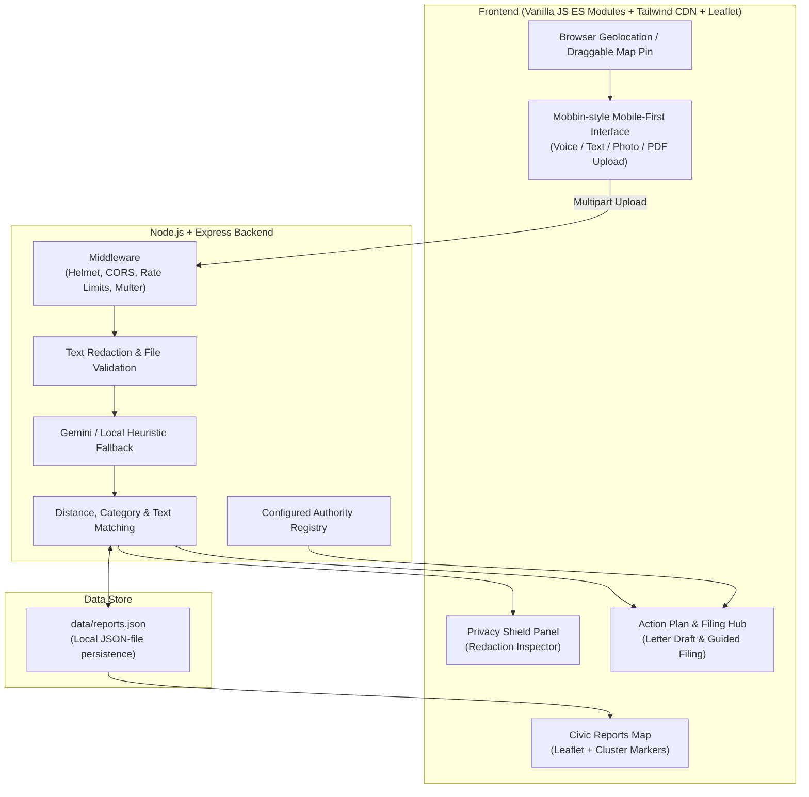

# CivicBridge
> **Gemini-powered civic complaint structuring, verification, and action planner for Pune, India.**

**Live demo:** [https://civicbridge-10c1.onrender.com](https://civicbridge-10c1.onrender.com)
*Hosted on Render's free tier; the first load may take about 50 seconds while the service wakes up.*

CivicBridge is a Gemini-powered app that acts as a bridge between citizen reports and civic follow-up. It accepts text and media evidence, structures complaints, checks them against local reports, and provides suggested next steps. It is designed for Pune-area civic issues; generated reports, matches, and authority suggestions should be checked before use.

## How this maps to the problem statement

> “A Gemini-powered app that acts as a universal bridge between human intent and complex systems, turning messy real-world inputs into structured, verified, life-saving actions.”

| Problem-statement stage | CivicBridge implementation |
| --- | --- |
| Messy input | Text, browser-recorded voice, photo/video/PDF evidence, with English, Hindi, and Marathi intake support. |
| Structured report | Gemini is asked to return a report matching a JSON schema; local heuristic fallback is used when no API key is configured. |
| Verified | Compares category, distance (up to 200 m), and text similarity against reports in `data/reports.json`. |
| Actionable | Suggests authority routing, online and offline steps, letter drafting, and a generated tracking token/status timeline. |
| Safe | Applies pattern-based PII redaction to text, strips selected image metadata, and handles uploaded media in memory rather than saving raw files to disk. |

## Tech Stack

* **Backend:** Node.js (>=20), Express, Helmet, Express Rate Limit, Multer memory storage, and CORS.
* **Frontend:** HTML, Tailwind CSS via CDN, vanilla JavaScript ES modules, and Leaflet.
* **AI:** Google Gemini (`@google/generative-ai`) with a response JSON schema for reports and multimodal evidence when a valid API key is configured. Without a key, the app uses a local heuristic demo mode.
* **Local persistence:** `data/reports.json` for report records; this is a JSON file, not a database.

---

## System Architecture



---

## End-to-End Civic Flow

1. **Multilingual Intake (Step 1):**
   * The form accepts typed text, browser `MediaRecorder` voice notes, and one photo/video/PDF attachment (up to 20 MiB per file) per analysis.
   * The Gemini prompt requests English, Marathi (मराठी), and Hindi (हिंदी) complaint handling. Local demo-mode classification uses keyword heuristics and is not equivalent to Gemini interpretation.
   * Quick-test prompt buttons provide sample Pune complaint text and coordinates.
2. **AI Structuring (Step 2):**
   * When a Gemini API key is configured, the service sends the complaint and attached media to Gemini and requests output conforming to a JSON schema. The response is checked against a Zod schema.
   * The report includes `category`, `subcategory`, `severity` (1-5), `description`, `location_text`, `lat`/`lng`, `evidence_summary`, `urgency_reason`, `responsible_authority`, and `confidence`.
   * Without an API key, local keyword heuristics create a demo report; they do not provide Gemini's audio, image, or document interpretation.
3. **Spatial & Community Verification (Step 3):**
   * Compares Haversine distance (within 200 m) to reports in `data/reports.json`; category/subcategory alignment or text similarity can produce a match.
   * With Gemini configured, text similarity may use Gemini; otherwise it uses lexical similarity.
   * Returns nearby matching records and a heuristic verification score. This is not official verification by a public authority.
4. **Action Plan & Authority Routing (Step 4):**
   * Selects a suggested authority from the local registry and generates a four-stage action plan.
   * Displays configured portal links, contact details, and SLA values (**verify before use**).
   * Provides suggested online instructions, offline guidance, and a generated grievance-letter draft.
   * Open manholes, exposed or fallen wires, flooding, and major road collapses are escalated as critical hazards. The result shows a red "Immediate safety advice" card and prioritizes emergency contact guidance; the app does not call or dispatch emergency services automatically.
5. **"File This Complaint" Hub (Step 5):**
   * **Guided online route:** Provides copy-ready text and a link to a configured external portal; citizens must submit through that portal themselves.
   * **Offline route:** Displays configured office guidance, document suggestions, and a suggested script (**verify contact and office details before use**).
   * **Sharing:** Creates WhatsApp and email links containing the generated complaint text.
   * **Local filing record:** The app's "File" actions add a report to `data/reports.json` and generate a token and four-stage status display. This does not submit the complaint to an authority or update status from an official system.
6. **Formal Letter Drafter & Privacy Shield:**
   * Generates a suggested letter in English, Marathi, or Hindi, including a subject and details from the configured report/authority.
   * Pattern-based text redaction covers Aadhaar-like numbers, phone numbers, email addresses, PAN-like strings, vehicle plates, and some name disclosures. Name detection is best effort and may miss or misidentify names.
   * Uploaded files are processed in memory, not saved as raw media files by the app. File buffers are scrubbed after the analysis pipeline completes; text can be sent to Gemini after redaction, and media can be sent to Gemini when configured.
   * The analysis form requires the citizen consent field.

---

## Project Structure

```
CivicBridge/
├── data/
│   └── reports.json           # Seed and locally filed report records
├── public/
│   ├── css/
│   │   └── style.css
│   ├── js/
│   │   ├── api.js
│   │   ├── app.js
│   │   ├── audio.js
│   │   ├── constants.js
│   │   ├── exif.js
│   │   ├── map.js
│   │   ├── tailwind-config.js
│   │   └── ui.js
│   └── index.html
├── server/
│   ├── config/
│   │   ├── constants.js
│   │   └── authorities.json   # Configured authority routing/contact information
│   ├── middleware/
│   │   └── errorHandler.js
│   ├── routes/
│   │   ├── authorityRoutes.js
│   │   ├── complaintRoutes.js
│   │   └── locationRoutes.js
│   ├── services/
│   │   ├── actionPlanService.js
│   │   ├── geminiService.js
│   │   ├── locationService.js
│   │   ├── redactService.js
│   │   └── verificationService.js
│   ├── tests/
│   │   ├── api.test.js
│   │   ├── gemini.test.js
│   │   ├── location.test.js
│   │   ├── redact.test.js
│   │   ├── security.test.js
│   │   └── verification.test.js
│   ├── utils/
│   │   ├── geo.js
│   │   └── validators.js
│   └── index.js
├── .env.example
├── .gitignore
├── package-lock.json
├── package.json
├── SECURITY.md
└── README.md
```

---

## Local Setup

### Prerequisites
* **Node.js** `>= 20.0.0`
* npm
* Optional: Google Gemini API key from [Google AI Studio](https://aistudio.google.com/). Without a configured key, report analysis uses the local demo-mode heuristic fallback.

### Installation

1. **Clone the repository and install dependencies:**
   ```bash
   npm install
   ```

2. **Configure Environment Variables:**
   ```bash
   cp .env.example .env
   ```
   Edit `.env`:
   ```env
   PORT=3000
   GEMINI_API_KEY=your_gemini_api_key_here
   GEMINI_MODEL=gemini-2.5-flash
   NODE_ENV=development
   # Optional comma-separated origins for a separately hosted frontend
   ALLOWED_ORIGINS=
   ```
   API CORS allows requests with no `Origin`, same-host requests, `http://localhost:3000`,
   and `RENDER_EXTERNAL_URL` when Render provides it. `ALLOWED_ORIGINS` adds any
   separately hosted frontend origins. Static files are not subject to CORS.

3. **Run the Test Suite:**
   ```bash
   npm test
   ```

   Use `npm run lint` to check JavaScript and `npm run format` to format source files.

4. **Start the Application:**
   ```bash
   npm start
   ```
   Open your browser at `http://localhost:3000`.

---

## Deployment on Render

CivicBridge can be deployed as a web service on [Render](https://render.com/):

1. **Create a New Web Service** on Render and connect this repository.
2. Configure settings:
   * **Environment:** `Node`
   * **Node Version:** `20` or higher (`engines: {"node": ">=20"}` enforced)
   * **Build Command:** `npm install`
   * **Start Command:** `npm start` (runs `node server/index.js`)
   * **Health Check Path:** `/health`
3. Under **Environment Variables**, add:
   * `GEMINI_API_KEY`: Your Gemini API key from AI Studio
   * `GEMINI_MODEL`: `gemini-2.5-flash`
   * `NODE_ENV`: `production`
   * `ALLOWED_ORIGINS`: Optional comma-separated origins when the frontend is hosted separately
4. Deploy. The server listens on `process.env.PORT` when Render supplies it.

---

## Security & Privacy

CivicBridge is **designed with DPDPA principles in mind**. Its implemented protections include:

* **Schema validation:** Zod schemas validate the complaint-analysis payload, structured report, letter-draft and filing requests; unknown fields are rejected by the strict request schemas. Reverse-geocoding coordinates are also validated.
* **Upload validation:** Multer stores uploads in memory with a 20 MiB limit per file. The server checks file signatures against supported image, video, document, and audio types. JPEG/PNG metadata stripping is implemented for selected metadata segments/chunks.
* **Prompt-injection handling:** The Gemini prompt marks complaint text as untrusted data, delimits it, and instructs the model not to follow instructions inside it. This is a mitigation, not a guarantee against prompt injection.
* **Helmet CSP:** A Content Security Policy allows the app's own resources, the Tailwind and Leaflet CDNs, and OpenStreetMap tile images. It does not allow `unsafe-eval`; inline styles are permitted.
* **Permissions Policy:** Camera, geolocation, and microphone are allowed for the same origin.
* **CORS:** Applied to `/api` routes only. Requests without an `Origin`, same-host requests, `http://localhost:3000`, `RENDER_EXTERNAL_URL` (when set), and origins listed in `ALLOWED_ORIGINS` are allowed. Other origins receive JSON 403 responses. Static assets do not use CORS middleware.
* **Rate limits:** The general API limit is 120 requests per 15 minutes per IP. Complaint analysis also has a 20-per-15-minute limit; reverse geocoding has a separate 60-per-15-minute limit. These use the default in-process rate-limit store.
* **Request and file limits:** JSON and URL-encoded bodies are limited to 1 MB. Uploaded files are limited to 20 MiB each and checked against file signatures.
* **PII redaction:** Pattern-based text redaction runs before complaint text is sent to Gemini or citizen notes are stored. It looks for Aadhaar-like numbers, Indian phone numbers, email addresses, PAN-like strings, vehicle registration patterns, and some name disclosures. **Name redaction is best effort** and does not guarantee that all personal information is found.
* **Media handling:** Raw uploaded media is processed in memory and not written as raw files to disk by these routes. Buffers are scrubbed after the successful analysis pipeline; attachments may be sent to Gemini when a key is configured.

For additional implementation details and stated limitations, see [SECURITY.md](./SECURITY.md).

## Testing

Run the automated test suite from the repository root:

```bash
npm test
```

Manual end-to-end check:

1. Start the app with `npm start` and open `http://localhost:3000`. Enter a text complaint; also try recording a voice note and selecting a photo. Test a PDF in a separate analysis if needed; the form accepts one primary file and one audio attachment per request.
2. Drag or click the map pin to set the complaint location.
3. Submit the complaint with consent enabled and confirm the structured report and action-plan sections appear. Configure `GEMINI_API_KEY` to exercise Gemini analysis; without it, the app uses demo heuristics.
4. Review the privacy/redaction panel and the nearby report matches. Results are application-generated checks, not official authority verification.
5. Use the guided filing flow, note the generated tracking token, and confirm that the report appears in the local report list/map. This checks the local filing record and generated timeline, not a live authority submission or status feed.

## Known Limitations

* The Render free tier may sleep between visits; the first request may take about 50 seconds to wake.
* Reports are stored in `data/reports.json`, not a database. On ephemeral hosting, records can be lost during restarts or redeployments.
* Authority links, phone numbers, WhatsApp details, office information, and SLA values come from local configuration and have not been independently verified here. **verify before use.**
* PII detection is pattern-based. Name detection is best effort, and redaction cannot guarantee that all sensitive information is removed.
* “File this complaint” creates a local record and generated token/timeline, and offers links or instructions for external filing. It is a guided/mock workflow, not a live municipal portal or API integration.
* Without a Gemini API key, the heuristic demo mode does not interpret audio, image, or PDF contents as Gemini would.

## Future Scope

* Replace JSON-file persistence with a real database.
* Integrate direct filing through official portals or APIs, where available.
* Add SMS or WhatsApp status updates through verified integrations.
* Provide ward-level analytics for municipal officials.
* Extend intake and report workflows to more Indian languages.

## License
MIT License. Built for the citizens of Pune, India.
